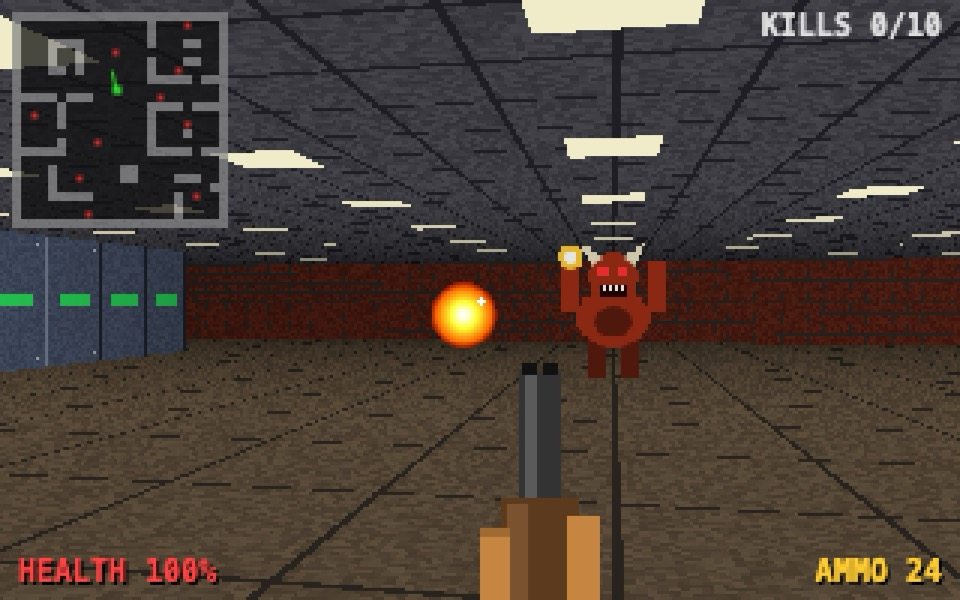

# Retro Raycaster

An old-school first-person shooter that runs in the browser, in the style of early-'90s raycasting games. It's one HTML file of plain JavaScript and Canvas 2D, with no libraries, build step or image files.

**Play:** https://www.stanleyluong.com/games/raycaster

## Features

- DDA raycasting renderer at 320×200, scaled up with crisp pixels
- Textured walls plus floor and ceiling casting, with distance fog
- Wall, sprite, sound and enemy art all generated in code
- Billboarded sprites, depth-tested per column against the wall buffer
- Enemies that wake on sight or gunfire, chase you and throw fireballs you can dodge
- Hitscan shotgun, medkit and ammo pickups, a minimap, and win and death states
- Sound effects synthesized with the Web Audio API

## Controls

| Key | Action |
| --- | --- |
| W A S D | Move and strafe |
| Mouse or ← → | Turn |
| Click or Space | Shoot |
| Shift | Run |
| M | Toggle the minimap |

## Run locally

Open `index.html` in a browser. Nothing needs installing.

## Editing the level

The level is the `MAP_SRC` grid in `index.html`. Digits `1`–`4` are wall types, `P` is where the player starts, `E` is an enemy, `H` is a medkit and `A` is ammo.
